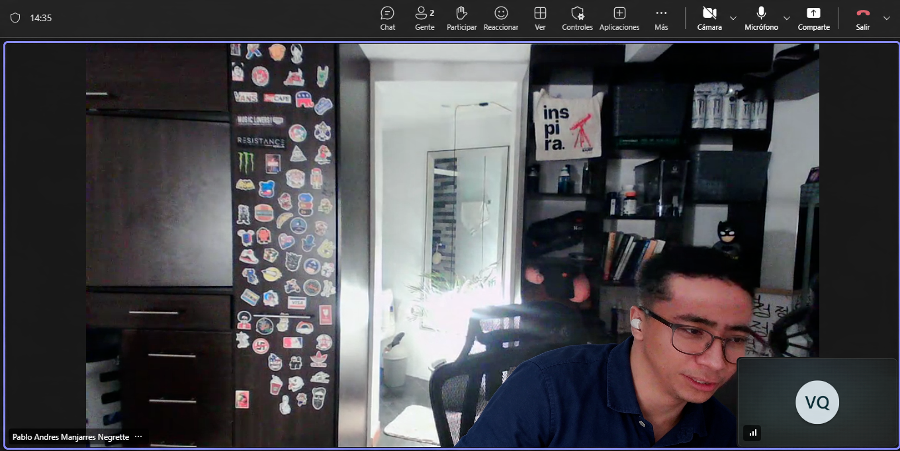
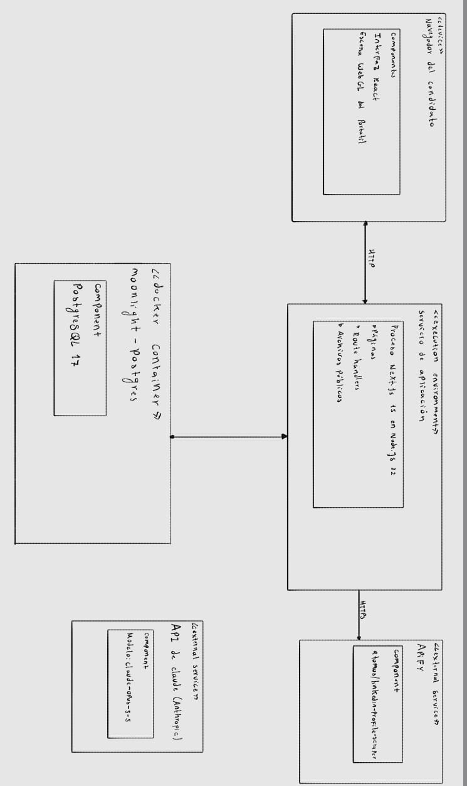

<p align="center">
  
</p>

<h1 align="center">Desarrollo del Sistema Profile Manager</h1>

<p align="center">
  <strong>Nombre del Producto:</strong> Moonlight<br />
  <strong>Equipo de trabajo:</strong> Pablo Manjarres, Valentina Barbosa<br />
  <strong>Versión:</strong> 3.0
</p>

<p align="center">
  <em>Universidad EAFIT — Departamento de Informática y Sistemas — Ingeniería de Software</em><br />
  <em>Entrega 3: Producto funcional</em>
</p>

---

## Contenido

- [Sección 1. Aspectos generales de la entrega](#sección-1-aspectos-generales-de-la-entrega)
- [Sección 2. Evaluación del Sprint anterior](#sección-2-evaluación-del-sprint-anterior)
- [Sección 3. Planificación del Sprint actual](#sección-3-planificación-del-sprint-actual)
- [Sección 4. Aspectos estructurales y arquitectónicos de la solución](#sección-4-aspectos-estructurales-y-arquitectónicos-de-la-solución)
- [Sección 5. Principios de diseño](#sección-5-principios-de-diseño)
- [Sección 6. Patrones de diseño](#sección-6-patrones-de-diseño)
- [Sección 7. Funcionalidad y demostración](#sección-7-funcionalidad-y-demostración)
- [Conclusiones y lecciones aprendidas](#conclusiones-y-lecciones-aprendidas)
- [Referencias](#referencias)

---

## Sección 1. Aspectos generales de la entrega

### Introducción

En el mercado laboral actual, los candidatos suelen enfrentarse a plataformas rígidas donde completar la información profesional es tedioso y las recomendaciones de empleo no reflejan con precisión su perfil real. Para responder a esta necesidad, se desarrolló Moonlight, una plataforma web diseñada para garantizar la completitud integral del perfil del usuario y ofrecer un motor base de recomendación de vacantes ajustado a sus competencias.

El presente documento constituye la tercera y última entrega del curso, enfocada en la consolidación del producto funcional. A lo largo de estas secciones se presenta la evaluación retrospectiva del Sprint 2, la planificación y ejecución del Sprint 3 (donde se integraron las funcionalidades de mayor complejidad técnica), y la especificación detallada de la arquitectura de la solución. Además, se documentan las vistas estructurales, el modelo de persistencia, la aplicación de principios y patrones de diseño, y las evidencias de funcionamiento real del sistema de cara a la validación con el Product Owner.

### Aporte de cada integrante

| Integrante        | Aporte en la Entrega 3                                                                                                                                                                        |
| ----------------- | --------------------------------------------------------------------------------------------------------------------------------------------------------------------------------------------- |
| Pablo Manjarres   | Rediseño de la interfaz, importación desde LinkedIn y hoja de vida, perfil adaptado, hoja de vida en formato Harvard, portátil 3D, registro de actividades, secciones 4 a 6, código y pruebas |
| Valentina Barbosa | {PENDIENTE: retrospectiva, planificación y sus evidencias, diagramas de clases de implementación y de despliegue, capturas, conclusiones, fuentes}                                            |

La demostración y la sustentación son de ambos.

---

## Sección 2. Evaluación del Sprint anterior

Técnica de Retrospectiva utilizada: Se aplicó la dinámica de las 4Ls (Liked, Learned, Lacked, Longed for) para evaluar tanto los resultados técnicos internos como la retroalimentación recibida durante la reunión de revisión (Sprint Review) con el Product Owner.   

Resultados del análisis:Liked (Lo que gustó): La estabilidad alcanzada en la arquitectura base con Docker y PostgreSQL, además de las 78 pruebas de dominio exitosas que respaldaron la entrega.Learned (Lo que se aprendió): A partir de los consejos recibidos por el Product Owner, comprendimos la importancia de que la identidad visual del producto refleje fielmente la marca del cliente. A nivel técnico, confirmamos que asegurar primero el flujo central del MVP facilita hacer ajustes visuales y funcionales posteriores sin romper la lógica del sistema.

Lacked (Lo que faltó): Una alineación estética más temprana con la paleta de colores corporativa de la marca, ya que en el sprint anterior se priorizó la estructura funcional sobre la identidad gráfica.

Longed for (Lo que se deseó): Haber validado los lineamientos visuales de la marca desde el diseño inicial de los prototipos para evitar retrabajos en los estilos de la interfaz.

Acciones de mejora aplicadas en el Sprint 3:  
Rediseño de identidad visual (UI): Ajustar la interfaz gráfica en Next.js para incorporar la paleta de colores oficial de la marca, siguiendo directamente las recomendaciones del Product Owner.
Refinamiento de funcionalidades críticas: Abordar desde el inicio del sprint las historias de mayor complejidad técnica (completitud total del perfil y sistema de recomendaciones) con criterios de aceptación claros.
Pruebas integrales: Ejecutar validaciones de punta a punta entre la interfaz renovada, la API en Express y la base de datos PostgreSQL antes de cerrar cada historia.

**Reuniones con el Líder Técnico y el PO:** {PENDIENTE: images/2-reunion.png}



---

## Sección 3. Planificación del Sprint actual

### Trabajo construido en el Sprint 3

| Cambio                                                                                                              | Impacto en la arquitectura                                                                                                                                |
| ------------------------------------------------------------------------------------------------------------------- | --------------------------------------------------------------------------------------------------------------------------------------------------------- |
| Registro de actividades de las postulaciones                                                                        | Nueva tabla `application_events` y una clase `ApplicationEvents` en el dominio (Observer)                                                                 |
| Interfaz rediseñada con la paleta y la tipografía de magneto365, en español                                         | Tailwind CSS reemplaza la hoja de estilos propia; los tokens de diseño viven en un solo archivo                                                           |
| Portátil 3D en el asistente del perfil: al hacer clic se abre y escribe en vivo lo que el candidato teclea          | three.js y react-three-fiber en el cliente; el modelo se construye en código, sin archivos de modelo                                                      |
| Ordenamiento de vacantes por match, salario o empresa                                                               | Comparadores intercambiables (Strategy) en la lista de vacantes                                                                                           |
| Sin pantalla de registro: la aplicación abre en el perfil de demostración                                           | Se retira `POST /api/candidates`; el inicio de sesión (#3, #32) no se evalúa en esta entrega                                                              |
| Se retira el servicio Express de la PoC, como decidió el ADR 0001                                                   | Un solo proceso de aplicación                                                                                                                             |
| Importación desde LinkedIn y desde la hoja de vida en PDF, con revisión y edición (#4 a #10)                        | `POST /api/imports` transmite el avance por _Server-Sent Events_; Apify lee LinkedIn y Claude lee el PDF                                                  |
| Perfil adaptado a una vacante sin inventar datos (#31)                                                              | `POST /api/profiles/[id]/tailor`; `checkTailored` en el dominio rechaza lo que no esté en el perfil                                                       |
| Hoja de vida en formato Harvard en `/cv`, lista para guardar como PDF                                               | `toHarvardCv` en el dominio arma el documento desde el perfil; un solo componente lo dibuja en todas las pantallas                                        |
| La hoja de vida adaptada junto a la original, con cada cambio marcado: lado a lado o solo los cambios (#31)         | `diffCv` y `diffWords` en el dominio calculan las diferencias palabra por palabra; la pantalla solo las pinta                                             |
| Validación, límite de solicitudes y registro sin datos personales (#33, #34, #36)                                   | `takeToken` en el dominio; `withRequestLog` envuelve cada ruta con un id de correlación                                                                   |
| Luna, una asistente en cada página: desde un chat edita el perfil, adapta la hoja de vida, busca vacantes y postula | `POST /api/assistant` corre un ciclo de herramientas con la API de Claude; cada herramienta usa las reglas del dominio y los repositorios que ya existían |
| Importar sin duplicar: lo de otra persona reemplaza el perfil y lo de la misma persona lo completa (#63)            | `applyImport` en el dominio une los cargos, estudios y habilidades repetidos en vez de agregarlos dos veces                                               |

### Historias priorizadas

Alcance y Historias de Usuario Priorizadas (Sprint 3):
Para este sprint final se priorizaron las 13 historias de usuario pendientes del backlog inicial (correspondientes al 37% de mayor complejidad técnica), sumadas a los ajustes de interfaz solicitados por el Product Owner:

Como usuario candidato, quiero gestionar y actualizar la totalidad de los campos de mi perfil profesional (100% de completitud) para habilitar el sistema de recomendaciones.

Como usuario, quiero visualizar un listado de vacantes recomendadas filtradas según la información registrada en mi perfil.

Como usuario, quiero registrar y actualizar el estado de mis postulaciones directamente desde la vista de vacantes.

### Ceremonias

- **Planning con _poker planning_:** {PENDIENTE: images/3-planning-poker.png}
- **Sprint backlog en el tablero:** {PENDIENTE: images/3-sprint-backlog.png y el link de la vista}

---

## Sección 4. Aspectos estructurales y arquitectónicos de la solución

### Arquitectura propuesta

Moonlight es una aplicación web en capas sobre un monorepo. Next.js 15 con App Router sirve tanto
las páginas como la API: cada carpeta de `apps/web/app/` es una ruta, los componentes de servidor
leen la base de datos a través de `apps/web/lib/queries.ts`, y los _route handlers_ de
`apps/web/app/api/` exponen la misma información como JSON. Debajo hay tres paquetes con una regla
de dependencia en un solo sentido: `packages/core` contiene las reglas de negocio y solo importa
`packages/types`; `packages/db` contiene todo el SQL; `apps/web` usa los tres. Así el motor de
puntaje se prueba sin base de datos y sin servidor. Dos servicios externos se llaman solo desde el
servidor, nunca desde el navegador: Apify, que lee un perfil público de LinkedIn, y la API de
Claude, que lee una hoja de vida en PDF y adapta el perfil a una vacante.

| Resumen de la arquitectura |                                                                                                                                                                                                                                                   |
| -------------------------- | ------------------------------------------------------------------------------------------------------------------------------------------------------------------------------------------------------------------------------------------------- |
| **Tipo Aplicación**        | Web                                                                                                                                                                                                                                               |
| **Estilo Arquitectónico**  | **Layered** (dominio, acceso a datos, aplicación). **Component-Based** (cada capa es un paquete con frontera propia). **Client/Server, 3-Tiers** (navegador → servidor Next.js → PostgreSQL). Se descartan SOA y Message Bus: es un solo servicio |
| **Lenguaje programación**  | TypeScript sobre Node.js 22                                                                                                                                                                                                                       |
| **Aspectos técnicos**      | PostgreSQL 17 en Docker; migraciones _forward-only_; sub-objetos del perfil en `JSONB`; la aplicación no arranca sin `DATABASE_URL`; servicios externos Apify y API de Claude con sus llaves en `.env.local`; modelo 3D construido en código      |
| **Frameworks**             | Next.js 15 y React 19; Tailwind CSS 4; three.js con react-three-fiber; SDK de Anthropic y zod; Turborepo y pnpm _workspaces_; Vitest                                                                                                              |

### Vista Lógica — Diagrama de Clases de Implementación

{PENDIENTE: images/4-clases-implementacion.png, dibujado por el equipo}

Lo que el diagrama debe mostrar, tal como está en el código:

- `ApplicationEvents` (`packages/core/src/activity.ts`): atributo `listeners`, métodos
  `subscribe(listener)` y `publish(event)`.
- Las reglas del dominio en `packages/core/src/index.ts`: `scoreVacancy`, `rankVacancies`,
  `profileCompleteness`, `marketGaps`, `canMove` y la tabla `ALLOWED_MOVES`.
- Los repositorios de `packages/db/src/repositories/`: perfiles, vacantes, postulaciones y eventos.
- Los tipos de `packages/types`: `Profile`, `Vacancy`, `Application`, `ApplicationEvent`,
  `ScoreResult`.
- Las reglas nuevas del dominio: `mapLinkedInProfile`, `applyImport`, `checkTailored`, `takeToken`,
  y las de la hoja de vida en `packages/core/src/cv.ts`: `toHarvardCv`, `diffCv` y `diffWords`.
- Los adaptadores a servicios externos de `apps/web/lib/`: `apify.ts`, `resume.ts`, `tailor.ts`,
  y el error común `UserFacingError`.
- Los _route handlers_ de `apps/web/app/api/`, el envoltorio `withRequestLog` y la fachada
  `apps/web/lib/queries.ts`.

### Vista Física — Diagrama de Despliegue



| Nodo / Proceso                  | Contenido                                                                       | Comunicación                                               |
| ------------------------------- | ------------------------------------------------------------------------------- | ---------------------------------------------------------- |
| Navegador del candidato         | Interfaz React; escena WebGL del portátil                                       | HTTP al mismo origen                                       |
| Servidor de aplicación          | Proceso Next.js 15 en Node.js 22: páginas, _route handlers_ y archivos públicos | TCP/SQL contra PostgreSQL                                  |
| Contenedor `moonlight-postgres` | PostgreSQL 17 con volumen persistente `moonlight-pgdata`                        | Puerto `5433` del anfitrión hacia el `5432` del contenedor |
| Apify                           | Actor `atomus/linkedin-profile-scraper`                                         | HTTPS desde el servidor de aplicación                      |
| API de Claude (Anthropic)       | Modelo `claude-opus-5-5`                                                        | HTTPS desde el servidor de aplicación                      |

### Persistencia

El motor es PostgreSQL 17. Es relacional porque el dominio lo es: una postulación une un perfil
con una vacante, los requisitos pertenecen a una vacante, y las restricciones `CHECK`, `UNIQUE` y
las llaves foráneas cuidan esas reglas en la base de datos. Los sub-objetos del perfil van en
`JSONB` porque se leen y se escriben completos.

| Tabla                  | Llaves y restricciones                                                                                     |
| ---------------------- | ---------------------------------------------------------------------------------------------------------- |
| `vacancies`            | PK `id`; `work_mode` en `remote`, `hybrid` u `onsite`                                                      |
| `vacancy_requirements` | PK (`vacancy_id`, `skill`); FK a `vacancies` en cascada; `kind` en `must-have` o `nice-to-have`            |
| `profiles`             | PK `id`; `email` único; habilidades, experiencia, educación y expectativas en `JSONB`                      |
| `applications`         | PK `id`; FK a `profiles` y `vacancies`; único (`profile_id`, `vacancy_id`); `status` en los cuatro estados |
| `application_events`   | PK `id`; FK a `profiles` y `vacancies`; `application_id` sin FK para que el historial sobreviva al retiro  |

{PENDIENTE: images/4-entidad-relacion.png, el diagrama E-R actualizado con `application_events`}

---

## Sección 5. Principios de diseño

### 5.1. Principios SOLID

| Principio                 | En Moonlight                                                                                                                                                         |
| ------------------------- | -------------------------------------------------------------------------------------------------------------------------------------------------------------------- |
| **Single Responsibility** | Cada repositorio de `packages/db/src/repositories/` toca una sola tabla; `scoreVacancy` solo puntúa y `describeEvent` solo redacta la línea del historial            |
| **Open/Closed**           | Un campo nuevo de completitud es una fila más en `COMPLETENESS_FIELDS`; un orden nuevo de vacantes es una entrada más en `SORTS`. Ninguna función cambia             |
| **Liskov Substitution**   | Todo oyente de `ApplicationEvents` cumple el mismo contrato `(event) => void \| Promise<void>`; el que guarda en la base y uno de prueba se intercambian sin cambios |
| **Interface Segregation** | Los formateadores de `apps/web/lib/format.ts` piden `Pick<Vacancy, ...>`: solo los campos que usan, no la vacante completa                                           |
| **Dependency Inversion**  | `packages/core` no depende de la base de datos; las rutas publican eventos sin saber quién los escucha, y el oyente se conecta en `apps/web/lib/events.ts`           |

### 5.2. Patrones GRASP

| Patrón                     | En Moonlight                                                                                                       |
| -------------------------- | ------------------------------------------------------------------------------------------------------------------ |
| **Bajo Acoplamiento**      | `packages/core` importa únicamente `packages/types`                                                                |
| **Alta Cohesión**          | Cada paquete agrupa una sola cosa: reglas, SQL, tipos o interfaz                                                   |
| **Experto**                | `profileCompleteness` y `scoreVacancy` viven junto a los datos del perfil y la vacante que necesitan               |
| **Creador**                | `createApplication` crea la postulación y `publish` en `apps/web/lib/events.ts` crea el evento con su id y su hora |
| **Controlador**            | Cada _route handler_ de `apps/web/app/api/` recibe la petición, valida y delega en el dominio y el repositorio     |
| **Polimorfismo**           | `SORTS` y `WEIGHTS` eligen el comportamiento por llave en lugar de cadenas de `if`                                 |
| **Fabricación Pura**       | `lib/queries.ts`, `lib/apify.ts`, `lib/resume.ts` y los repositorios existen para separar responsabilidades        |
| **Indirección**            | `ApplicationEvents` se interpone entre las rutas que cambian una postulación y el registro de actividades          |
| **Variaciones protegidas** | `parseProfile` reconstruye todo perfil que llega por HTTP; `mapLinkedInProfile` aísla el formato del scraper       |

### 5.3. Clean Code

- **Nombres que dicen qué hacen:** `comparisonBlockers`, `topGaps`, `canMove`, `describeEvent`.
- **Funciones puras y pequeñas** en el dominio: mismas entradas, mismo resultado, sin E/S.
- **Una sola fuente para cada regla:** las etiquetas de estado, los pesos y los campos de
  completitud se definen una vez en `packages/core` y la interfaz los importa.
- **Errores explícitos:** las rutas responden 400, 404 o 409 con un mensaje, y la aplicación se
  detiene al iniciar si falta `DATABASE_URL`.
- **Pruebas del dominio:** 83 pruebas en `packages/core/tests` que corren sin base de datos.

---

## Sección 6. Patrones de diseño

### Observer

|                           |                                                                                                                                                                                                                              |
| ------------------------- | ---------------------------------------------------------------------------------------------------------------------------------------------------------------------------------------------------------------------------- |
| **Nombre del patrón**     | Observer                                                                                                                                                                                                                     |
| **Clasificación**         | Comportamiento                                                                                                                                                                                                               |
| **Intención**             | Que el registro de actividades reaccione a cada cambio de una postulación sin que las rutas sepan que existe                                                                                                                 |
| **Aplicabilidad**         | Un cambio debe disparar efectos secundarios que pueden crecer (historial hoy, notificaciones mañana)                                                                                                                         |
| **Estructura**            | {PENDIENTE: images/6-observer.png}                                                                                                                                                                                           |
| **Participantes**         | Sujeto: `ApplicationEvents`. Oyente: la función que llama `recordEvent`. Evento: `ApplicationEvent`                                                                                                                          |
| **Colaboraciones**        | La ruta cambia la postulación y llama `publish`; el sujeto avisa a cada oyente; el oyente guarda la fila en `application_events`                                                                                             |
| **Consecuencias**         | (+) agregar un efecto es suscribir un oyente; un oyente que falla no tumba la petición. (−) el flujo es menos evidente al leer la ruta                                                                                       |
| **Implementación**        | `publish` usa `Promise.allSettled` y devuelve los fallos para registrarlos en el log                                                                                                                                         |
| **Código de ejemplo**     | [`packages/core/src/activity.ts`](https://github.com/pablomanjarres/Magneto/blob/main/packages/core/src/activity.ts), [`apps/web/lib/events.ts`](https://github.com/pablomanjarres/Magneto/blob/main/apps/web/lib/events.ts) |
| **Usos conocidos**        | Los eventos del DOM (`addEventListener`) y `EventEmitter` de Node.js                                                                                                                                                         |
| **Patrones relacionados** | Mediator, Publish/Subscribe                                                                                                                                                                                                  |

### Strategy

|                           |                                                                                                                                    |
| ------------------------- | ---------------------------------------------------------------------------------------------------------------------------------- |
| **Nombre del patrón**     | Strategy                                                                                                                           |
| **Clasificación**         | Comportamiento                                                                                                                     |
| **Intención**             | Cambiar el orden de la lista de vacantes sin tocar el código que filtra y pagina                                                   |
| **Aplicabilidad**         | Varias formas de resolver lo mismo (ordenar) elegidas por el usuario en tiempo de ejecución                                        |
| **Estructura**            | {PENDIENTE: images/6-strategy.png}                                                                                                 |
| **Participantes**         | Contexto: la lista en `VacancyFilters`. Estrategias: los comparadores `match`, `salary` y `company` de `SORTS`                     |
| **Colaboraciones**        | El selector "Ordenar por" guarda una llave; la lista llama `sort(SORTS[llave])`                                                    |
| **Consecuencias**         | (+) un orden nuevo es una línea. (−) cada estrategia debe respetar el mismo contrato de comparación                                |
| **Implementación**        | Un `Record<SortKey, comparador>` tipado: el compilador exige una estrategia por llave                                              |
| **Código de ejemplo**     | [`apps/web/app/jobs/VacancyFilters.tsx`](https://github.com/pablomanjarres/Magneto/blob/main/apps/web/app/jobs/VacancyFilters.tsx) |
| **Usos conocidos**        | `Array.prototype.sort` con comparador; los ordenamientos de cualquier portal de empleo                                             |
| **Patrones relacionados** | State, Template Method                                                                                                             |

### Repository

|                           |                                                                                                                          |
| ------------------------- | ------------------------------------------------------------------------------------------------------------------------ |
| **Nombre del patrón**     | Repository                                                                                                               |
| **Clasificación**         | Estructura (patrón de arquitectura de acceso a datos)                                                                    |
| **Intención**             | Que el resto de la aplicación pida perfiles, vacantes y postulaciones sin escribir SQL                                   |
| **Aplicabilidad**         | Una capa de dominio que no debe conocer la base de datos                                                                 |
| **Estructura**            | {PENDIENTE: images/6-repository.png}                                                                                     |
| **Participantes**         | Repositorios de `packages/db/src/repositories/`; entidades de `packages/types`; el _pool_ de conexiones                  |
| **Colaboraciones**        | La ruta llama `getProfile` o `listVacancies`; el repositorio consulta y convierte las filas en objetos del dominio       |
| **Consecuencias**         | (+) todo el SQL en un paquete; cambiar el motor no toca el dominio. (−) una capa más entre la ruta y la tabla            |
| **Implementación**        | Funciones con consultas parametrizadas y un convertidor fila→entidad por tabla (`toVacancy`, `toApplication`, `toEvent`) |
| **Código de ejemplo**     | [`packages/db/src/repositories/`](https://github.com/pablomanjarres/Magneto/tree/main/packages/db/src/repositories)      |
| **Usos conocidos**        | Spring Data, Doctrine, Entity Framework                                                                                  |
| **Patrones relacionados** | Data Mapper, Facade                                                                                                      |

### Facade

|                           |                                                                                                                                    |
| ------------------------- | ---------------------------------------------------------------------------------------------------------------------------------- |
| **Nombre del patrón**     | Facade                                                                                                                             |
| **Clasificación**         | Estructura                                                                                                                         |
| **Intención**             | Dar a las páginas una sola puerta para leer datos y a la interfaz una sola puerta para escribir                                    |
| **Aplicabilidad**         | Varias páginas necesitan la misma combinación de repositorios y reglas del dominio                                                 |
| **Estructura**            | {PENDIENTE: images/6-facade.png}                                                                                                   |
| **Participantes**         | Fachadas: `apps/web/lib/queries.ts` (lectura) y `apps/web/lib/client.ts` (escritura). Subsistemas: repositorios, dominio y API     |
| **Colaboraciones**        | El panel llama `loadRanked(profile)`, que trae las vacantes, las puntúa y calcula las brechas en una sola llamada                  |
| **Consecuencias**         | (+) las páginas solo componen; la consulta no se copia por ruta. (−) la fachada crece si se le agregan casos que no comparten nada |
| **Implementación**        | Funciones exportadas que combinan repositorios con funciones puras de `packages/core`                                              |
| **Código de ejemplo**     | [`apps/web/lib/queries.ts`](https://github.com/pablomanjarres/Magneto/blob/main/apps/web/lib/queries.ts)                           |
| **Usos conocidos**        | `fetch` sobre la pila HTTP; los SDK de servicios en la nube                                                                        |
| **Patrones relacionados** | Repository, Mediator                                                                                                               |

### State

|                           |                                                                                                                                            |
| ------------------------- | ------------------------------------------------------------------------------------------------------------------------------------------ |
| **Nombre del patrón**     | State (dirigido por tabla)                                                                                                                 |
| **Clasificación**         | Comportamiento                                                                                                                             |
| **Intención**             | Que una postulación solo pueda moverse a los estados permitidos desde el estado en que está                                                |
| **Aplicabilidad**         | Un objeto con pocos estados y transiciones fijas                                                                                           |
| **Estructura**            | {PENDIENTE: images/6-state.png}                                                                                                            |
| **Participantes**         | Estados: `applied`, `in-review`, `interview`, `rejected`. Tabla de transiciones: `ALLOWED_MOVES`. Guardia: `canMove`                       |
| **Colaboraciones**        | El tablero muestra solo los movimientos de `ALLOWED_MOVES`; la ruta `PATCH` vuelve a validar con `canMove` y responde 409 si no se permite |
| **Consecuencias**         | (+) la tabla se lee y se prueba de un vistazo. (−) estados con comportamiento propio pedirían clases por estado                            |
| **Implementación**        | Un `Record<ApplicationStatus, ApplicationStatus[]>` en el dominio, compartido por la interfaz y la API                                     |
| **Código de ejemplo**     | [`packages/core/src/index.ts`](https://github.com/pablomanjarres/Magneto/blob/main/packages/core/src/index.ts)                             |
| **Usos conocidos**        | Flujos de pedidos y de tickets en sistemas de gestión                                                                                      |
| **Patrones relacionados** | Strategy                                                                                                                                   |

### Adapter

|                           |                                                                                                                                               |
| ------------------------- | --------------------------------------------------------------------------------------------------------------------------------------------- |
| **Nombre del patrón**     | Adapter                                                                                                                                       |
| **Clasificación**         | Estructura                                                                                                                                    |
| **Intención**             | Que un registro de LinkedIn y una hoja de vida en PDF lleguen al perfil con la misma forma, `ImportedProfile`                                 |
| **Aplicabilidad**         | Dos fuentes con formatos que no controlamos y que el resto de la aplicación no debe conocer                                                   |
| **Estructura**            | {PENDIENTE: images/6-adapter.png}                                                                                                             |
| **Participantes**         | Adaptados: el registro del actor de Apify y la salida de Claude. Adaptadores: `mapLinkedInProfile` y `readResume`. Destino: `ImportedProfile` |
| **Colaboraciones**        | La ruta de importación llama al servicio, pasa su respuesta por el adaptador y entrega `ImportedProfile` a la pantalla de revisión            |
| **Consecuencias**         | (+) si el scraper cambia su formato, solo cambia `mapLinkedInProfile`. (−) un campo nuevo de la fuente no aparece hasta mapearlo              |
| **Implementación**        | Funciones puras que leen el registro campo por campo, descartan lo desconocido y normalizan fechas con `toYearMonth`                          |
| **Código de ejemplo**     | [`packages/core/src/import.ts`](https://github.com/pablomanjarres/Magneto/blob/main/packages/core/src/import.ts)                              |
| **Usos conocidos**        | Los conectores de cualquier ATS que importa hojas de vida de varias fuentes                                                                   |
| **Patrones relacionados** | Facade, Repository                                                                                                                            |

---

## Sección 7. Funcionalidad y demostración

**Repositorio:** https://github.com/pablomanjarres/Magneto

### Árbol de directorios

```
moonlight/
├── apps/
│   └── web/
│       ├── app/            # páginas: dashboard, jobs, applications, onboarding, profile, cv, import
│       │   └── api/        # route handlers: la API HTTP
│       ├── components/     # piezas reutilizables, la hoja de vida (cv/) y el portátil 3D (toys/)
│       ├── lib/            # fachadas de lectura y escritura, y el bus de eventos
│       └── public/samples/ # una hoja de vida de ejemplo para probar la importación
├── packages/
│   ├── core/               # dominio: puntaje, completitud, brechas, estados, eventos
│   ├── db/                 # SQL: migraciones, semilla y repositorios
│   └── types/              # tipos compartidos
├── data/                   # 50 vacantes, el perfil de demostración y dos de prueba
├── docs/                   # entregas, ADR, diagramas
└── infra/                  # PostgreSQL 17 en Docker
```

### Código de ejemplo por capa

Dominio, `packages/core/src/index.ts`:

```ts
export function canMove(from: ApplicationStatus, to: ApplicationStatus): boolean {
  return ALLOWED_MOVES[from].includes(to);
}
```

Acceso a datos, `packages/db/src/repositories/applications.ts`:

```ts
const { rows } = await pool.query<ApplicationRow>(
  "UPDATE applications SET status = $2, updated_at = now() WHERE id = $1 RETURNING *",
  [id, status],
);
```

API, `apps/web/app/api/applications/[id]/route.ts`:

```ts
const application = await updateApplicationStatus(id, body.status);
await record(application, "moved", `${current.status}→${application.status}`);
return Response.json({ application });
```

### Historias de usuario demostradas

| HU       | Historia                                            | Dónde se ve                                                                                        |
| -------- | --------------------------------------------------- | -------------------------------------------------------------------------------------------------- |
| #11, #16 | Guardar mi perfil y ver qué tan completo está       | `/onboarding`: el portátil 3D escribe en vivo cada campo y la completitud sube mientras se escribe |
| #23, #24 | Ver mi puntaje y las vacantes ordenadas por match   | `/jobs` y `/jobs/[id]`; el panel muestra las tres mejores coincidencias                            |
| #30, #43 | Seguir mis postulaciones y anotar el próximo paso   | `/applications`: tablero de cuatro estados, próximo paso y registro de actividades                 |
| #4 a #10 | Importar mi perfil desde LinkedIn o mi hoja de vida | `/import`: escaneo animado con el avance real, revisión por sección con su origen y edición        |
| #31      | Ver mi perfil adaptado a una vacante                | `/jobs/[id]`: la hoja de vida original y la adaptada en formato Harvard, con cada cambio marcado   |

### Demostración pedida por la guía

- **Lista con registros de la base de datos y una acción por registro:** el tablero de
  `/applications` lee la tabla `applications`; cada tarjeta se mueve de estado o se retira.
- **Formulario lanzado desde la lista que manipula datos:** "Editar próximo paso" actualiza con
  `PATCH /api/applications/[id]`, "Retirar" borra con `DELETE` y "Postularme", en el detalle de una
  vacante, inserta con `POST /api/applications`. Cada acción queda en "Actividad reciente".
- El inicio de sesión no se evalúa en esta entrega: la aplicación abre directo en el perfil.

**Capturas:** {PENDIENTE: images/7-panel.png, 7-vacantes.png, 7-detalle.png, 7-postulaciones.png,
7-asistente.png}

---

## Conclusiones y lecciones aprendidas

{PENDIENTE: síntesis del documento, aportes, hallazgos y dificultades de esta fase, escrita por el
equipo}

---

## Referencias

- Gamma, E., Helm, R., Johnson, R. y Vlissides, J. (1994). _Design Patterns: Elements of Reusable
  Object-Oriented Software_. Addison-Wesley.
- Larman, C. (2004). _Applying UML and Patterns_ (3.ª ed.). Prentice Hall.
- Martin, R. C. (2008). _Clean Code: A Handbook of Agile Software Craftsmanship_. Prentice Hall.
- Microsoft. _Architectural Patterns and Styles_. <http://msdn.microsoft.com/en-us/library/ee658117.aspx>
- Apify. _LinkedIn Profile Scraper (atomus/linkedin-profile-scraper)_.
  <https://apify.com/atomus/linkedin-profile-scraper>
- Anthropic. _Claude API documentation_. <https://platform.claude.com/docs>
- Decisión de arquitectura del equipo: [`docs/adr/0001-backend-choice.md`](../../../adr/0001-backend-choice.md)

{PENDIENTE: otras fuentes consultadas durante el sprint}

{PENDIENTE: herramientas de IA utilizadas y los _prompts_ con los que se usaron}

---

<p align="center">
  <em>Universidad EAFIT — Departamento de Informática y Sistemas — Ingeniería de Software</em>
</p>
